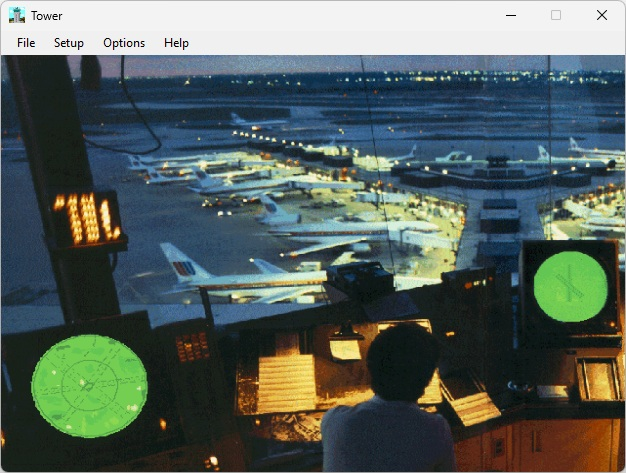

<div align="center">

# ✈ Tower
### A classic control tower simulation, reconstructed for modern Windows

**BRITE radar · ASDE ground surveillance · Voice communications · Aircraft & scenery**

[Website](https://www.tower-sim.com) · [Original project repository](https://github.com/Sibra-Soft/tower) · [Releases](https://github.com/Sibra-Soft/tower/releases)



</div>

> **Project status — November 2026:** This is an independent, in-development reconstruction inspired by BAO Tower, not a fully accurate emulator or an official BAO/Microsoft release. Promotional artwork is concept imagery; archival screenshots depict the original application.

## 🛫 Welcome to the tower

Guide flights from initial contact to landing, taxi or departure. **Tower** combines a classic Windows-style control tower interface with a new C#/.NET simulation engine. This reconstruction is informed by original documentation, assets and observations of the 1990s simulator.

## ✨ Features

| System | What's included |
| --- | --- |
| **TowerView** | Interactive airport viewpoint, original aircraft meshes and selected scenery/panoramas |
| **BRITE** | Airborne traffic radar, range controls, targets and labels |
| **ASDE** | Ground radar, runway and taxiway traffic |
| **Aircraft & traffic** | Arrival and departure flows, runway clearances and taxi handling |
| **Radio** | Classic VOC phrase composition or optional Windows speech, with radio effects |
| **Flight strips** | Arrival/departure strip management and print preview |
| **Sessions** | Practice mode, controller scoring, save and resume |
| **Controls** | Typed ATC commands, pause and simulation speed adjustments |

Supported behavior is a reconstruction rather than a promise of historically exact flight dynamics, radar timing or scoring.

## 🎧 Voice and original data

The runtime can compose phrases using recovered original voice banks and can use installed Windows English speech voices in its alternative speech mode. Original `.VOC` files and airport data are required.

## ⌨️ Example commands

```text
AAL176/CL          # Cleared to land
DAL253/T14         # Taxi toward runway 14
DAL253/HS9         # Hold short of runway 9
AAL176/ERB14R/CL   # Combined instructions
```

The actual accepted commands depend on the current aircraft and runway state. The full user guide and command reference documentation provide further detail.

## 🧰 Technical overview

- **Language / UI:** C#, .NET, Windows Forms
- **Simulation:** Dedicated shared state for radar, tower view and strips
- **Aircraft models:** 44 original `.DBT` catalog types connected to TowerView
- **Scenery:** Canyon assets and Washington/O'Hare panoramic source imagery
- **Speech:** Original 8-bit mono PCM at 8,900 Hz, plus Windows speech as an explicit alternative
- **Testing:** xUnit regression tests and Windows build validation

## 📦 Download and build

See the [Releases](https://github.com/Sibra-Soft/tower/releases) page for published packages.

## 🐞 Report a bug

Found a problem with **TOWER**? Bug reports help us improve the simulator and preserve the classic experience.

Before submitting a report, please [check existing issues](https://github.com/Sibra-Soft/tower/issues) to avoid duplicates. When opening a new issue, include:

- **TOWER version** and **Windows version**
- **What happened** and **what you expected**
- **Steps to reproduce** the problem
- **Airport, scenario and commands used**, if relevant
- **Screenshots or logs**, when useful (please remove private information)

**[Report a bug on GitHub](https://github.com/Sibra-Soft/tower/issues/new)**

## 💡 Suggestions and feature requests

Have an idea for an improvement, a new feature, or additional airport scenery? We'd love to hear it! Community suggestions are always welcome, whether you're rediscovering the original simulator or trying TOWER for the first time.

You can [open a GitHub Issue](https://github.com/Sibra-Soft/tower/issues/new) to discuss an idea with the project or contact us directly.

## ✉️ Get in touch

For questions, feedback, collaboration or a friendly conversation about the project, contact **Sibra-Soft**:

**[alex@sibra-soft.nl](mailto:alex@sibra-soft.nl)**

We are always open to suggestions and ideas. For bugs that need tracking, please use GitHub Issues so progress stays visible.

## 📜 Attribution

This is an independent fan recreation. **BAO Tower**. The project is not affiliated with or endorsed by the original publisher or Microsoft.

---

<div align="center"><em>“Take your position in the control tower.”</em></div>
